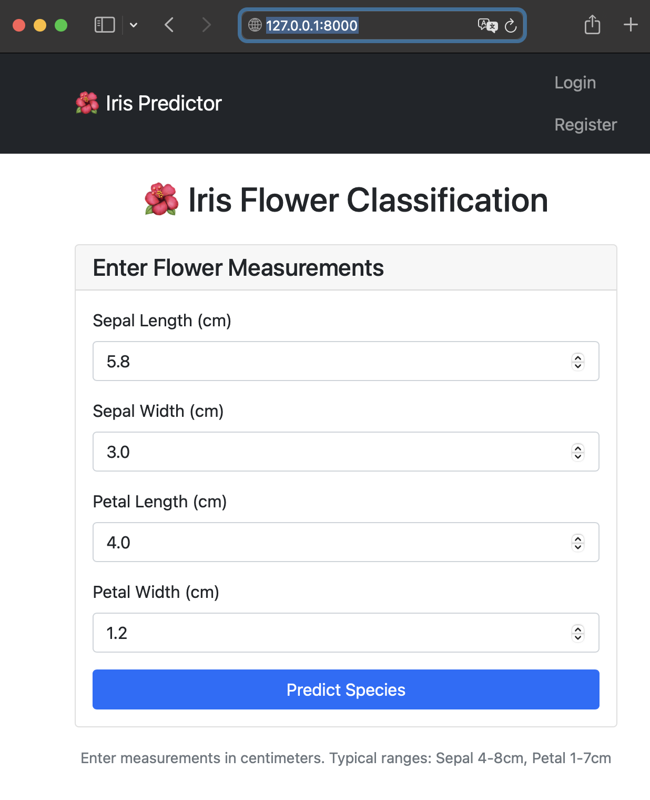
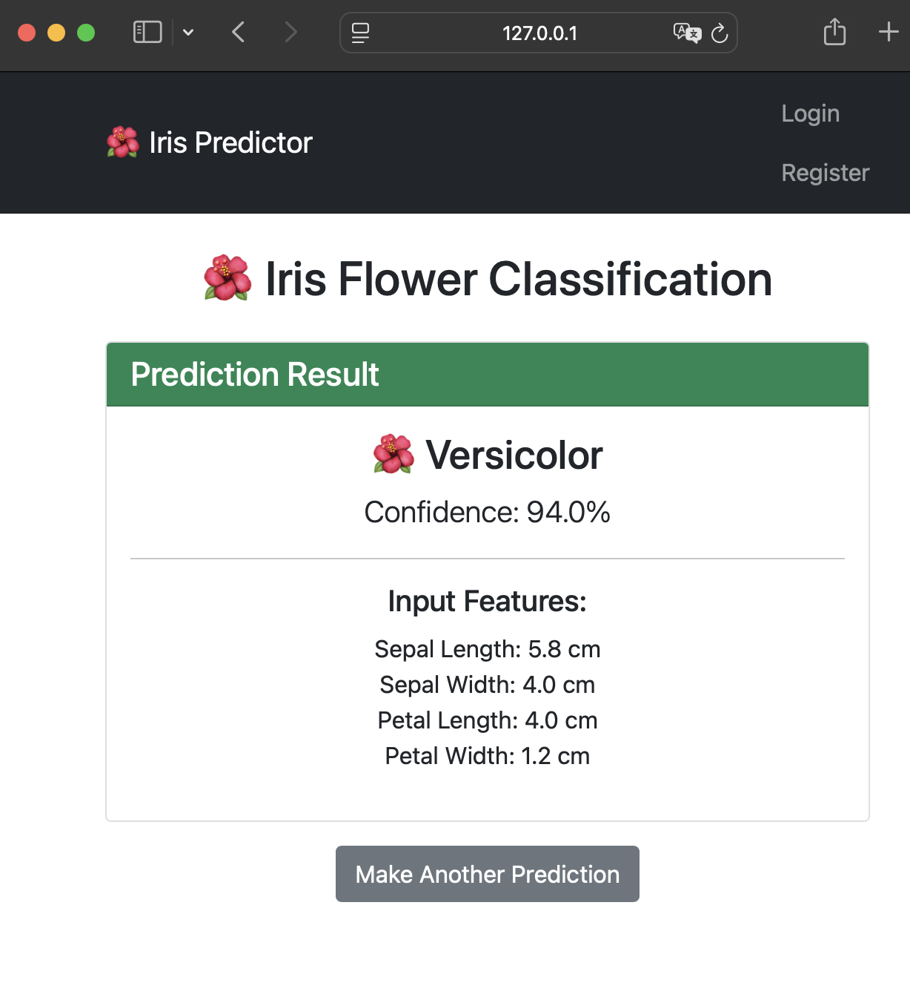
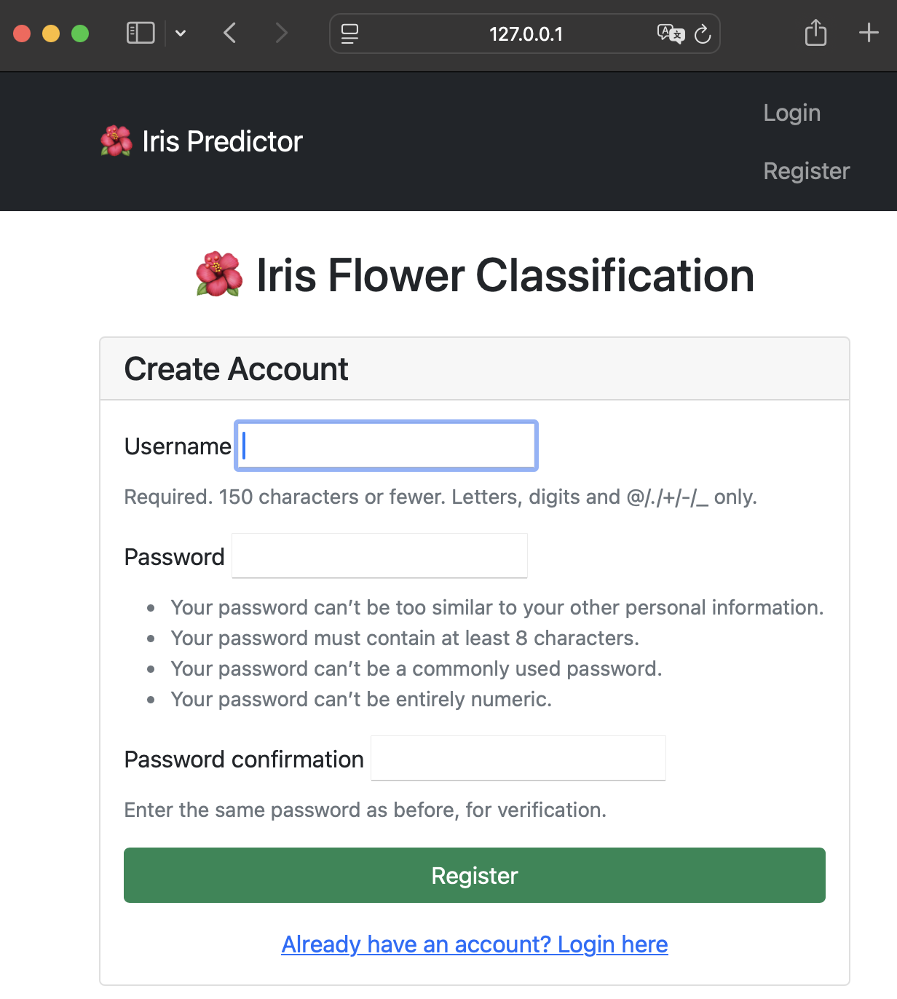
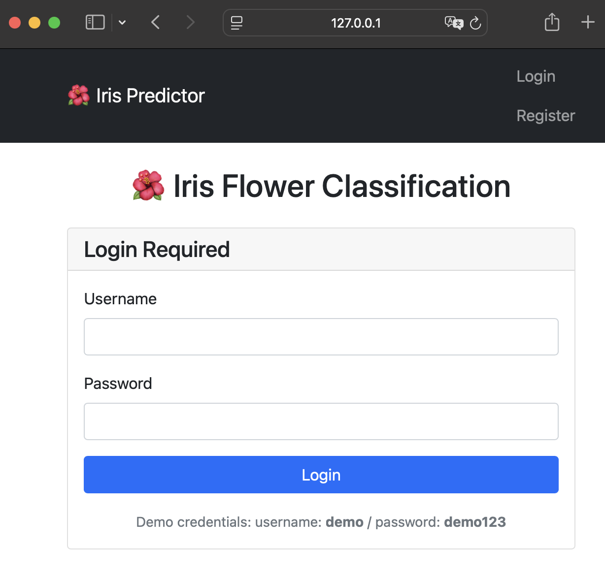
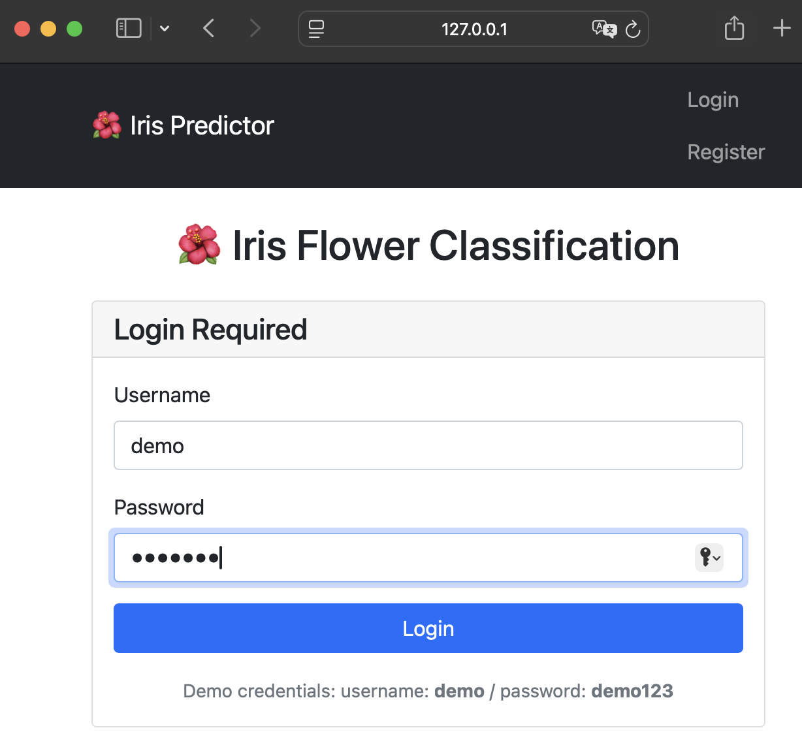
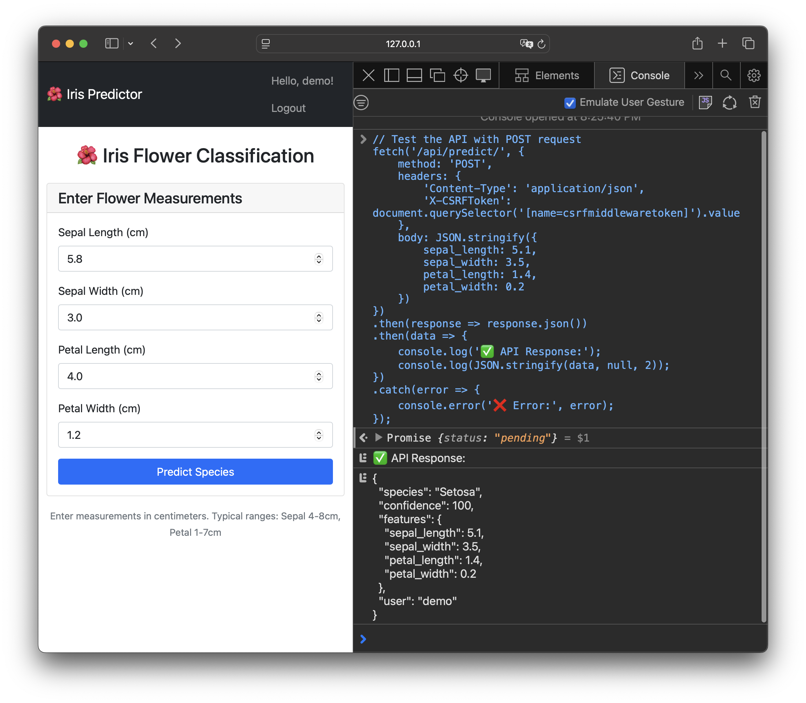

# Iris Flower Classification Web Application

A Django-based web application that deploys a machine learning model to classify Iris flower species based on their measurements.

## 🌺 Project Overview

This project demonstrates how to deploy a machine learning model using Django, featuring:

- **Machine Learning Model**: Random Forest classifier trained on the Iris dataset
- **Web Interface**: User-friendly forms for making predictions
- **User Authentication**: Registration, login, and logout functionality
- **REST API**: Protected API endpoint for programmatic access
- **Responsive Design**: Bootstrap-styled interface

## 🚀 Features

- **Flower Classification**: Predict Iris species (Setosa, Versicolor, Virginica) from measurements
- **User Management**: Secure registration and authentication system
- **REST API**: JSON API for integration with other applications
- **Real-time Predictions**: Instant results with confidence scores
- **Error Handling**: Comprehensive validation and error messages

## 📸 Application Screenshots

### Home Page

*Main interface with input form for flower measurements*

### Prediction Result

*Example prediction showing species and confidence level*

### User Registration

*User registration form for creating new accounts*

### Login Page

*Secure login interface for existing users*

*Secure login interface for existing users (Demo User)*

### API Response

Sample JSON response from the REST API


## 🛠️ Installation & Setup

### Prerequisites
- Python 3.7+
- Django 4.0+
- scikit-learn
- pandas, numpy, joblib

### Quick Start

1. **Clone the repository**
   ```bash
   git clone <repository-url>
   cd my_django_ml_project
   ```

2. **Install dependencies**
   ```bash
   pip install django scikit-learn pandas numpy joblib
   ```

3. **Set up the database**
   ```bash
   python manage.py migrate
   ```

4. **Train the machine learning model**
   ```bash
   python train_model.py
   ```

5. **Create a superuser (optional)**
   ```bash
   python manage.py createsuperuser
   ```

6. **Run the development server**
   ```bash
   python manage.py runserver
   ```

7. **Access the application**
   - Open http://127.0.0.1:8000 in your browser
   - Register a new account or use existing credentials

## 🔌 API Usage

### Protected Endpoint
- **URL**: `POST /api/predict/`
- **Authentication**: Required (user must be logged in)
- **Content-Type**: `application/json`

### Example Request
```bash
curl -X POST http://127.0.0.1:8000/api/predict/ \
  -H "Content-Type: application/json" \
  -H "Cookie: sessionid=YOUR_SESSION_ID" \
  -d '{
    "sepal_length": 5.1,
    "sepal_width": 3.5,
    "petal_length": 1.4,
    "petal_width": 0.2
  }'
```

### Example Response
```json
{
  "species": "Setosa",
  "confidence": 95.23,
  "features": {
    "sepal_length": 5.1,
    "sepal_width": 3.5,
    "petal_length": 1.4,
    "petal_width": 0.2
  },
  "user": "demo"
}
```

## 📁 Project Structure

```
my_django_ml_project/
├── ml_project/                 # Django project configuration
├── predictor/                  # Main application
│   ├── templates/predictor/    # HTML templates
│   ├── views.py               # Business logic and ML integration
│   └── urls.py               # Application URL routing
├── iris_model.pkl             # Trained ML model
├── train_model.py             # Model training script
├── test_api.py               # API testing utility
├── manage.py                 # Django management script
└── db.sqlite3               # SQLite database (auto-generated)
```

## 🧠 Machine Learning Details

- **Model**: Random Forest Classifier
- **Dataset**: Iris dataset (150 samples, 3 classes)
- **Features**: Sepal length, sepal width, petal length, petal width
- **Accuracy**: ~97% on test set
- **Training**: See `train_model.py` for complete implementation

## 👥 User Management

The application includes:
- User registration with form validation
- Secure login/logout functionality
- Session-based authentication
- Protected API endpoints
- User-specific API responses

## 🎯 Usage Examples

### Web Interface
1. Navigate to the home page
2. Enter flower measurements (in centimeters)
3. Click "Predict Species"
4. View the prediction results with confidence score

### Programmatic Access
1. Login through web interface to get session cookie
2. Use the session cookie to authenticate API requests
3. Send POST requests with JSON data to `/api/predict/`

## 🔧 Configuration

Key settings in `ml_project/settings.py`:
- `LOGIN_REDIRECT_URL = '/'` - Redirect to home after login
- `LOGOUT_REDIRECT_URL = '/'` - Redirect to home after logout
- `DEBUG = True` - Development mode (set to False in production)

## 🐛 Troubleshooting

### Common Issues

1. **"no such table: auth_user"**
   - Run `python manage.py migrate`

2. **Model not loading**
   - Ensure `iris_model.pkl` exists in project root
   - Run `python train_model.py` to generate it

3. **API returns 403 Forbidden**
   - Ensure user is logged in
   - Include valid session cookie in requests

4. **Template errors**
   - Verify `predictor` is in `INSTALLED_APPS` in settings.py

## 📝 License

This project is for educational purposes as part of a data science deployment lab.

## 🤝 Contributing

This is a lab project demonstrating Django ML deployment. Feel free to use it as a reference for your own projects!

---

**Note**: This application is designed for educational purposes and demonstration. For production use, consider adding additional security measures, error handling, and performance optimizations.